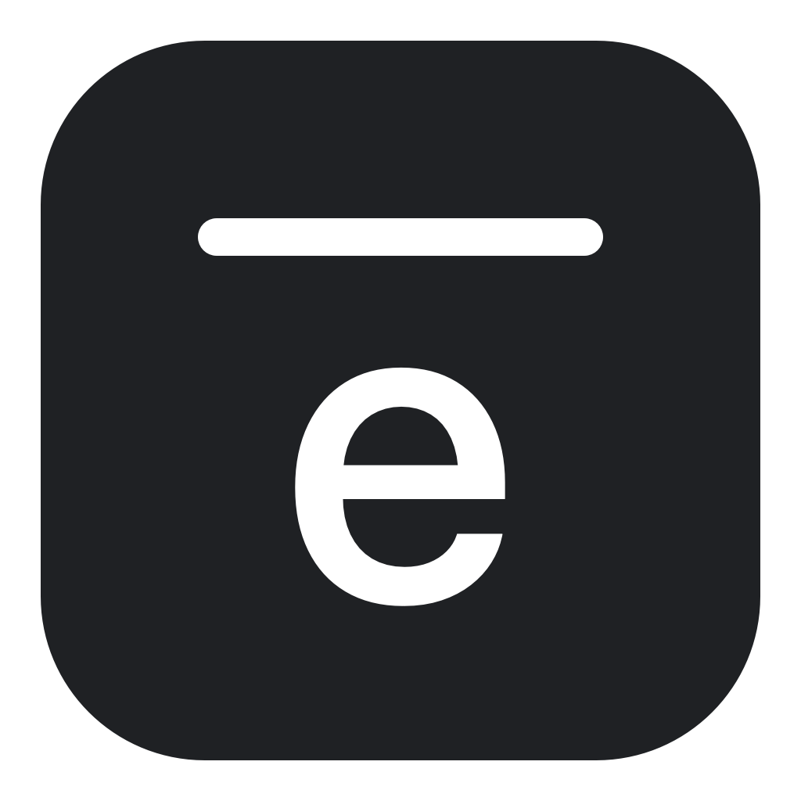

# Eave

**Make your Mac yours.**

A minimal, open-source macOS utility for customizing your menu bar.

[](LICENSE)
[](https://github.com/digitalapplebee/eave/actions/workflows/ci.yml)

Eave puts a color band in a separate copy of a supported still wallpaper. Your real menu bar, icons and interactions stay in place. It runs from the menu bar, without a permanent Dock icon.

**Release status:** the source is public, and v0.1.0 is prepared locally. No downloadable GitHub release has been published yet. Check [Releases](https://github.com/digitalapplebee/eave/releases) for future installers, or build locally with the commands below. The [release checklist](docs/releasing.md) records the checks needed before distributing a binary release.

**Screenshots:** genuine UI and desktop-effect captures are still needed. The icon above is the actual app icon; no preview artwork is presented as a system screenshot. See the [capture guide](docs/screenshots/README.md).

## Features

- Black, Graphite, Dark Gray, Gray and White presets, plus a native custom color picker.
- Adjustable opacity; Hide Notch uses opaque black.
- Separate Light and Dark color profiles, with Follow System automation.
- A native SwiftUI popover with a live preview, Settings and About windows.
- Persistent preferences and Launch at Login through macOS Login Items.
- Per-display composition, display/Space/wake event handling and a recovery journal.
- No accounts, analytics, subscriptions, updater or application network requests.

**Use a local still PNG, JPEG, TIFF or HEIF image.** Dynamic/Aerial wallpapers, including Golden Gate, are not customized when their configuration cannot be preserved. Unknown sources or incomplete placement information are left untouched. macOS controls the final menu-bar tint and text color; an exact displayed HEX color is not guaranteed.

## Install without Xcode

Once the maintainer publishes a release:

1. Open [Releases](https://github.com/digitalapplebee/eave/releases) and read the version's compatibility and signing notes.
2. Download `Eave-v0.1.0.dmg` or `Eave-v0.1.0.zip`, along with `SHA256SUMS.txt` to verify the download.
3. Open the DMG and drag **Eave** to **Applications**, or extract the ZIP and move `Eave.app` there.
4. Open Eave from Applications, then click its icon in the macOS menu bar.
5. Enable customization for a supported still wallpaper. The first launch starts with the effect disabled.

The locally prepared v0.1.0 artifacts are **ad-hoc signed, not Developer ID signed or notarized**. Downloaded copies can be blocked by Gatekeeper. If you trust the source and macOS offers it after an attempted launch, use **System Settings → Privacy & Security → Open Anyway**, following [Apple's supported approval workflow](https://support.apple.com/en-us/102445). Do not disable Gatekeeper globally. A release is notarized only if its notes explicitly say so.

Place the downloaded assets and checksum manifest in the same folder, then run:

```sh
shasum -a 256 -c SHA256SUMS.txt
```

## Use Eave

Click the menu-bar icon and turn on **Enable Eave**. Choose a preset, open the custom color well, or adjust opacity. **Hide Notch** overrides the selected color with opaque black; it does not change resolution or move the native menu bar.

Choose **Follow System**, **Light** or **Dark**. In Settings, edit the separate color profiles and enable **Launch at Login**. macOS may require approval in Login Items. Install Eave in its permanent location before registering it for login.

Turn Eave off to restore visible desktops. **Visit every affected Space and reconnect affected displays while Eave is disabled before quitting.** Quit also tries to restore visible desktops; it keeps Eave open and explains restoration failures. If an older version recorded a system poster instead of the original Dynamic Wallpaper, select the wallpaper you want again in System Settings.

The preview inside Eave represents the selected style; it is not evidence that macOS has accepted or displayed the effect. Read the status for unsupported sources, errors or pending confirmation.

## Compatibility

| Platform | Status |
| --- | --- |
| macOS 27.0.1, Apple Silicon | Local build, tests, menu-bar-agent startup and no-write preservation checks verified. Full static-desktop visual acceptance is still pending. |
| macOS 26, Apple Silicon | Minimum deployment target and hosted build/test target. Check CI for automated results; physical desktop behavior remains unverified. |
| macOS 25 or earlier | Unsupported by the deployment target. |
| Intel Macs | Not included in the current arm64 distribution. |

Multiple-display, hot-plug, sleep/wake and Space handling are implemented. Their physical acceptance checklist, along with auto-hide and full-screen behavior, is in [rendering validation](docs/rendering-validation.md). A successful build is not a claim that every desktop configuration works.

## Build from source

Requirements: an Apple Silicon Mac, macOS 26 or later, and a Swift 6.2-or-newer toolchain with a macOS 26 SDK. The locally verified environment is Xcode 27.1 / Swift 6.4 on macOS 27.0.1. [Hosted CI](https://github.com/digitalapplebee/eave/actions/workflows/ci.yml) selects Xcode 26.6 on the macOS 26 arm64 runner.

Clone the repository:

```sh
git clone https://github.com/digitalapplebee/eave.git
cd eave
```

Alternatively, use **Code → Download ZIP**, extract the source, and open its directory in Terminal.

```sh
swift build
swift test
./Scripts/build-app.sh debug
open dist/Eave.app
```

Open `Package.swift` directly in Xcode with **File → Open**, select the Eave scheme, and build. This is a Swift package; no generated `.xcodeproj` is needed. Use the packaged `.app` to test bundle metadata, its icon and Login Items. Quit Eave before replacing its bundle.

To test, build Release and create both installers:

```sh
./Scripts/release.sh --dmg
./Scripts/validate-artifacts.sh
```

Outputs:

```text
dist/Eave.app
dist/release/Eave-v0.1.0.zip
dist/release/Eave-v0.1.0.dmg
dist/release/SHA256SUMS.txt
```

Omit `--dmg` for ZIP-only packaging. These commands do not publish anything. See [releasing](docs/releasing.md) for versions, signing, notarization and GitHub preparation.

## How it works

Eave reads the visible desktop's image URL and placement options through `NSWorkspace`, checks the source, and renders an independent copy with ImageIO and Core Graphics. Geometry comes from `NSScreen`. It records the original URL/options before calling `setDesktopImageURL`; it never edits an original wallpaper or uses generated output as the next source.

Rendering runs outside the UI actor, slider changes are combined, and stale work cannot replace newer settings. System events replace continuous polling. The journal supports recovery after a restart and avoids overwriting wallpaper changes made outside Eave.

Public APIs have limits:

- Dynamic/video/Light–Dark wallpapers and system-managed posters have no supported preservation path. A readable single-frame poster is not treated as the selected dynamic configuration.
- Only visible desktops can be restored immediately. Other Spaces/disconnected displays retain recovery records. Applying an image may turn off macOS **Show on all Spaces**.
- The band remains part of the wallpaper when the menu bar auto-hides. Full-screen apps may obscure it.
- System appearance changes select Eave's saved profile; Eave does not change the system appearance itself.
- Scripted wallpaper changes are noticed on the next relevant event or manual check, not by a polling timer.

Details: [architecture](docs/architecture.md), [troubleshooting](docs/troubleshooting.md), and [validation evidence](docs/rendering-validation.md).

## Privacy

The application contains no analytics, account system, network client or automatic updater. It requests neither Screen Recording nor Accessibility access. Launch at Login uses `SMAppService` and may need system approval. Eave is a directly distributed, unsandboxed utility with an empty entitlement file; ordinary file APIs access wallpaper sources.

Preferences use UserDefaults key `eave.settings.v1`. With the default bundle ID, recovery metadata and generated copies are stored in:

```text
~/Library/Application Support/com.eaveapp.Eave/
```

The local journal contains wallpaper file URLs and display UUIDs. Unified Logging includes display identifiers and geometry at debug level; error text is private. Do not upload journals or unreviewed logs/screenshots to a public issue. See [SECURITY.md](SECURITY.md).

## Uninstall safely

1. Turn Eave off. Visit all affected Spaces and reconnect affected displays; confirm restoration and resolve any error first.
2. Turn off **Launch at Login** in Eave or remove it from macOS Login Items.
3. Quit Eave, then move `Eave.app` from Applications to the Trash.
4. Optionally remove default-bundle preferences with `defaults delete com.eaveapp.Eave`. A custom bundle ID uses a different domain.
5. Only after every affected desktop has been restored, optionally move Eave's Application Support folder to the Trash in Finder. Keep it if any Space uses a generated wallpaper or needs recovery.

Never delete original wallpaper files. Removing the app alone does not restore unreachable Spaces or a dynamic-provider configuration lost by an older version.

## Community

Use [Issues](https://github.com/digitalapplebee/eave/issues) to report bugs or request features. See [CONTRIBUTING.md](CONTRIBUTING.md), [CODE_OF_CONDUCT.md](CODE_OF_CONDUCT.md), [SECURITY.md](SECURITY.md), and [CHANGELOG.md](CHANGELOG.md). Discussions is not enabled.

## License

[MIT](LICENSE), copyright © 2026 digitalapplebee. The [license inventory](docs/license-audit.md) records the source/dependency audit and separate terms for Apple resources and the Code of Conduct.
